# EcoSense

EcoSense is a lightweight Python project designed to help users identify typical household waste and make a more informed decision about how it should be handled. Instead of relying on guesswork, the app asks for a few details about an item, checks whether the information is valid, classifies the waste, and then offers a practical recommendation.

This project is built as a simple command-line application, which makes it easy to run, test, and modify. It is especially useful for beginner projects because it combines several core Python concepts such as validation, file handling, data modeling, modular design, and basic statistics.

---

## Overview

The main goal of EcoSense is to make waste sorting more approachable. In everyday life, people often do not know whether an item should go into recyclable waste, general waste, compost, or an e-waste collection stream. EcoSense reduces that uncertainty by giving a structured classification workflow.

A user enters:

- item name
- material
- condition
- quantity

The application validates the input, assigns a category, calculates a status, and saves the result so it can be reviewed later.

---

## Key Features

- Waste classification based on common materials
- User input validation
- Sorting status generation for each item
- Recycling and disposal recommendations
- Record saving to a CSV file
- Waste history display
- Search across past records
- Basic statistics for stored items
- Simple menu-driven interface
- Modular project structure for easier maintenance

---

## Supported Materials

EcoSense recognizes the following materials:

| Material | Category      |
| -------- | ------------- |
| plastic  | Plastic Waste |
| paper    | Paper Waste   |
| glass    | Glass Waste   |
| metal    | Metal Waste   |
| organic  | Organic Waste |
| e-waste  | E-Waste       |

The program accepts only these values, which helps prevent invalid data entry and keeps the classification logic consistent.

---

## How the Application Works

The flow is straightforward:

1. The user opens the app.
2. They choose an option from the main menu.
3. They enter waste details such as name, material, condition, and quantity.
4. The program validates the input.
5. The waste is classified into a category.
6. A recommendation is generated.
7. The record is saved to the CSV data file.
8. The user can later view history, search entries, or inspect statistics.

---

## Main Menu

When the app starts, the user sees a menu like this:

```text
1. Classify Waste
2. View Waste History
3. Search Records
4. View Statistics
5. View Recycling Recommendations
6. Exit
```

Each menu option connects to a dedicated part of the application.

---

## Project Structure

```text
EcoSense/
├── main.py
├── classifier.py
├── validation.py
├── recommendation.py
├── models.py
├── history.py
├── statistics.py
├── utilities.py
├── requirements.txt
├── README.md
├── statement.md
├── data/
│   └── waste_records.csv
├── design/
├── screenshots/
├── tests/
│   ├── __init__.py
│   └── test_project.py
└── .gitignore
```

---

## Module Breakdown

### main.py

This is the entry point of the application. It displays the menu, handles user choices, and connects the main features together.

### classifier.py

This module contains the rule-based classification logic. It maps each accepted material to the appropriate category.

### validation.py

This module checks user input to prevent empty names, invalid materials, bad quantities, and unsupported conditions.

### recommendation.py

This module contains recycling and disposal advice for each material type.

### models.py

This file defines the `WasteItem` data model, which stores key information such as item name, material, quantity, category, status, and recommendation.

### history.py

This module handles reading, saving, displaying, and searching stored waste records.

### statistics.py

This module reads historical data and calculates simple statistics such as quantity totals and averages.

### utilities.py

This file stores helper functions used throughout the project, including formatting and status-related logic.

---

## Data Storage

EcoSense stores entries in a CSV file located at:

```text
data/waste_records.csv
```

Each saved record includes details such as:

- item name
- material
- condition
- quantity
- category
- status
- recommendation

This keeps the system lightweight and easy to debug without needing a database.

---

## Installation

1. Make sure Python is installed on your system.
2. Open a terminal in the project folder.
3. Install the required packages:

```bash
python -m pip install -r requirements.txt
```

---

## Running the Project

From the project directory, use:

```bash
python main.py
```

The application starts in the console and guides the user through the available options.

---

## Example Workflow

```text
Select option: 1
Item name: Water bottle
Material: plastic
Condition: clean
Quantity: 2
```

The program then classifies this item as plastic waste, determines its status, and saves the entry with a suitable recycling suggestion.

---

## Validation and Error Handling

EcoSense includes basic validation so the app behaves more predictably. Examples include:

- rejecting empty item names
- rejecting unsupported materials
- requiring a positive quantity
- accepting only valid conditions such as clean, dirty, or damaged

This is important because small data-entry mistakes can otherwise create misleading records.

---

## Testing

The project includes a simple automated test suite in:

```text
tests/test_project.py
```

You can run the tests with:

```bash
python -m tests.test_project
```

These tests cover major logic such as classification, validation, and recommendation output.

---

## Why This Project Is Useful

EcoSense is a good demonstration of how a real-world problem can be simplified into a beginner-friendly Python application. It shows how a small project can combine:

- user interaction
- modular code organization
- validation rules
- structured data storage
- statistics and reporting
- practical recommendation logic

It is simple enough to understand quickly, while still showing several important programming concepts in one place.

---

## Future Improvements

This version is intentionally compact, but the project can be expanded in many ways:

- add image-based waste recognition
- build a graphical user interface
- add more material categories
- link to a real database
- include nearby recycling center information
- add multilingual support
- create better analytics and reporting

---

## Summary

EcoSense is a practical Python-based waste classification system that helps users organize waste records, understand disposal options, and keep a simple history of previous entries. It is a beginner-friendly project that demonstrates how Python can be used to solve a real-world problem with a clear workflow and a modular code structure.


### 19.2 Workflow Diagram

The workflow diagram shows the main steps followed by the program while processing a waste item.


### 19.3 Use Case Diagram

The use case diagram shows the main actions that a user can perform in EcoSense.


### 19.4 Class Diagram

The class diagram shows the WasteItem class, its attributes, and its methods.


### 19.5 Sequence Diagram

The sequence diagram shows the order in which the user and different parts of the program interact while a waste item is being classified.

### 19.6 Component Diagram

The component diagram shows the main software components of EcoSense and their connections.


### 19.7 Data Storage Diagram

The data storage diagram shows how waste records are stored in the CSV file and used by the program.


---

## 20. Screenshots

The following screenshots demonstrate the main features of EcoSense and some of the testing performed during development.

Note: The screenshots are stored inside the `screenshots` folder of this repository.

### 20.1 Waste History

The waste history screen displays previously stored waste records.

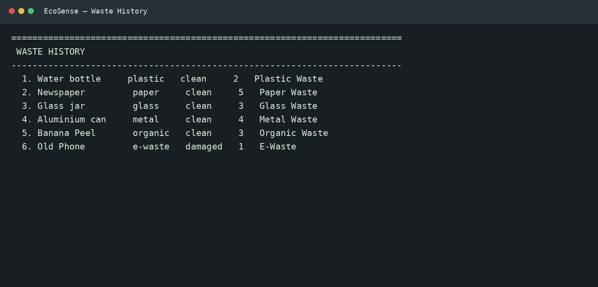

Additional Waste History View

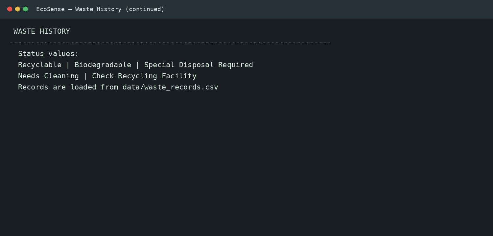

### 20.2 Search

The search feature allows the user to find stored waste records.

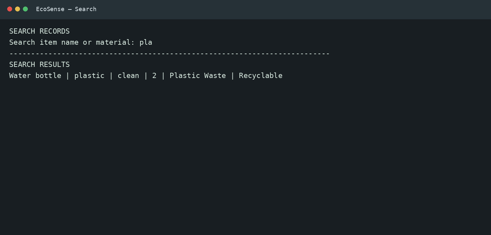

### 20.3 Waste Statistics

The statistics feature displays basic information calculated from stored waste records.

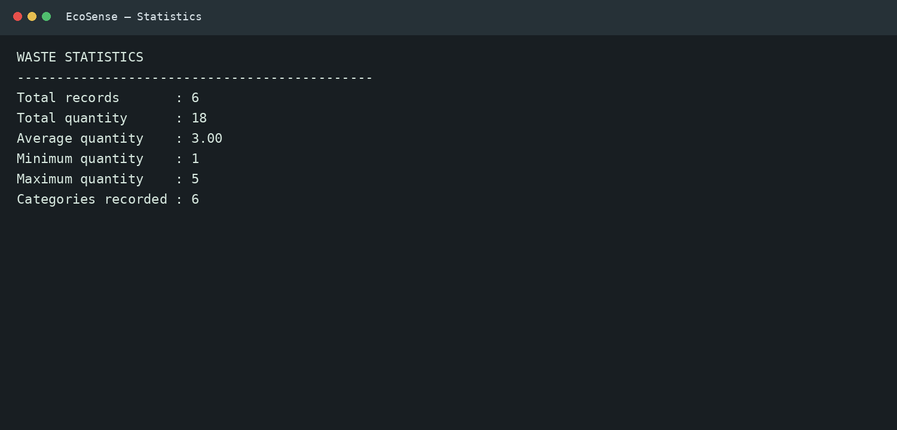

### 20.4 Recycling Recommendations

The recommendation feature displays recycling or disposal suggestions for supported waste materials.

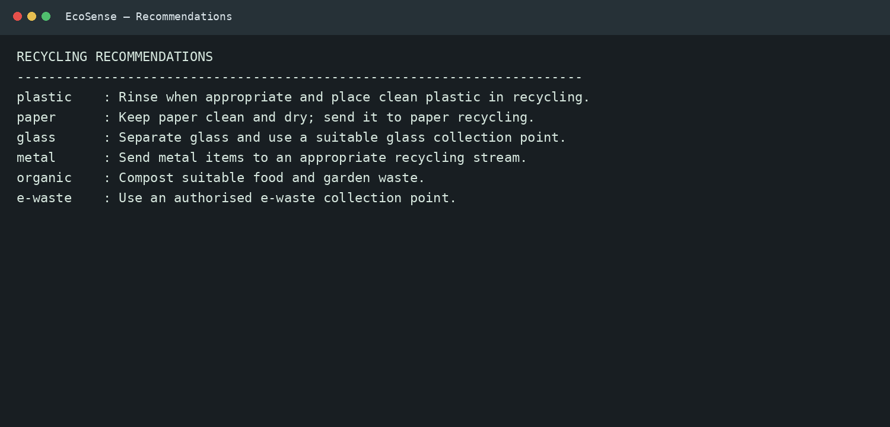

### 20.5 Error Handling

EcoSense checks invalid inputs and displays appropriate error messages.

General Error Handling

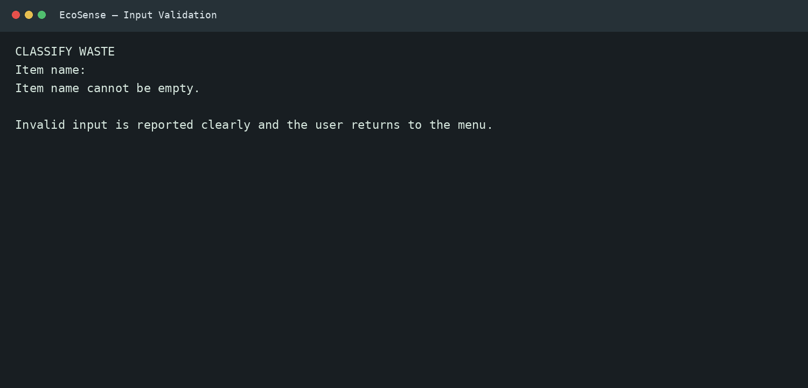

Quantity Validation

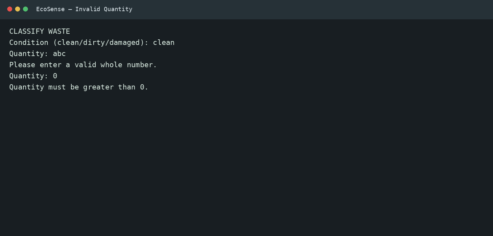

Condition Validation

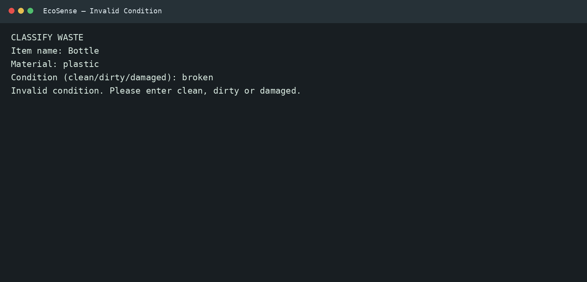

Material Validation

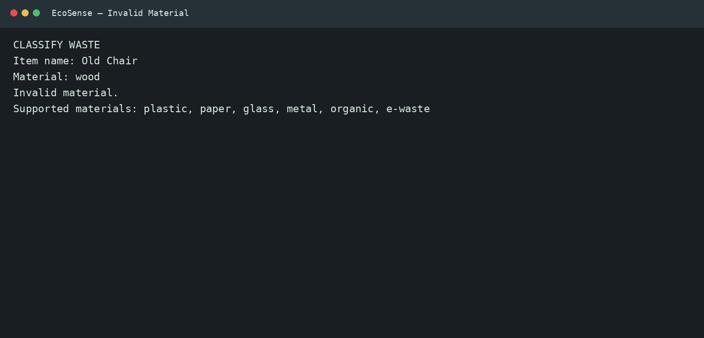

### 20.6 CSV Storage

The CSV file stores the waste records entered by the user.

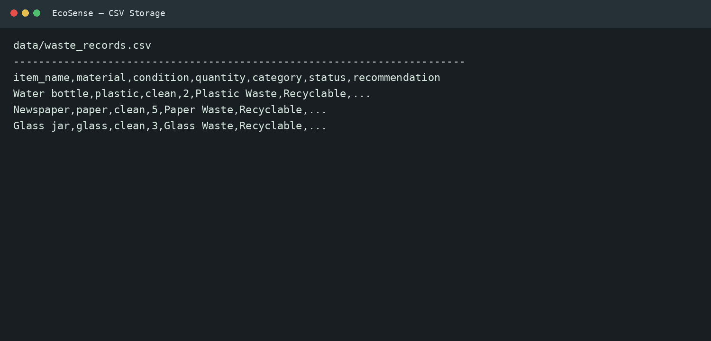

### 20.7 Automated Testing

The test output demonstrates that the implemented tests completed successfully.

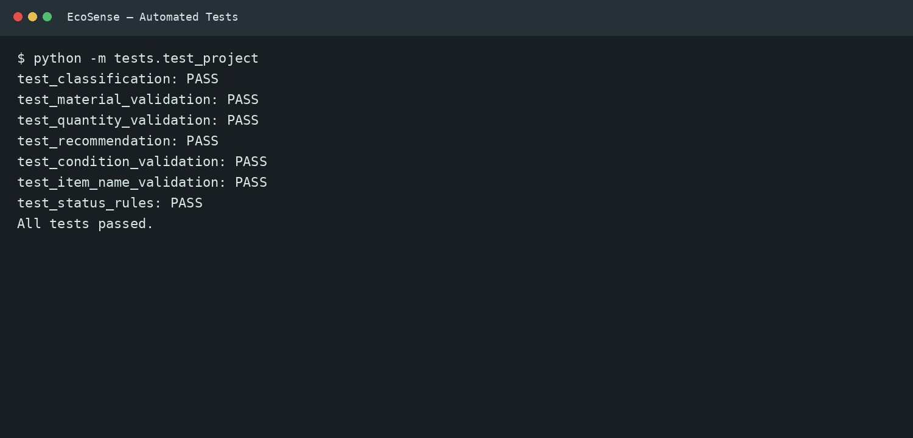

---

## 21. Future Improvements

The current version of EcoSense is a rule-based system.

There are several ways in which the project could be improved in the future.

Possible improvements include:

- Adding image-based waste recognition.
- Using a camera to identify waste items.
- Using machine learning for automatic classification.
- Creating a graphical user interface.
- Developing a mobile application.
- Adding multilingual support.
- Showing nearby recycling centres.
- Adding charts and more detailed waste analysis.
- Connecting the application to a database.
- Adding user accounts.
- Adding cloud-based storage.

These are future ideas and are not part of the current version of the project.

---

## 22. What I Learned From This Project

Working on EcoSense helped me understand how different Python concepts can be used together in one project.

Through this project, I learned:

- How to divide a program into different modules.
- How functions can be used to handle specific tasks.
- How lists, dictionaries, and sets can be used to organize information.
- How to read and write data using CSV files.
- How to validate user input.
- How to handle errors using exceptions.
- How classes and objects can be used in Python.
- How NumPy can be used for calculations.
- How basic testing can be added to a project.
- How to organize a complete project using files and folders.
- How different modules can communicate with each other.
- How to build a complete Python application from smaller components.

I also gained a better understanding of how a simple idea can be divided into smaller tasks and then connected together to create a working application.

---

## 23. Conclusion

EcoSense is a simple Python project that combines waste classification, recycling recommendations, data storage, searching, and basic statistics in one application.

The project helped me apply different concepts from the Python course, including:

- Functions
- Modules
- Data structures
- File handling
- Exception handling
- NumPy
- Object-Oriented Programming
- Testing

The current version focuses on common waste materials and provides basic recommendations based on the information entered by the user.

It also stores the records so they can be viewed and searched later.

Although the current system is simple, it provides a foundation for adding more advanced features such as image recognition, machine learning, graphical interfaces, databases, and mobile applications in the future.

---

## 24. Project Author

EcoSense – Smart Waste Classification & Recycling Assistant

Developed as a first-year B.Tech CSE project using Python.

---

## 25. Repository Overview

The repository contains:

```text
Python Source Code
        │
        ├── Classification
        ├── Validation
        ├── Recommendations
        ├── History Management
        ├── Statistics
        └── Utilities
                │
                ↓
        CSV Data Storage
                │
                ↓
        Testing
                │
                ↓
        Screenshots & Diagrams
```
